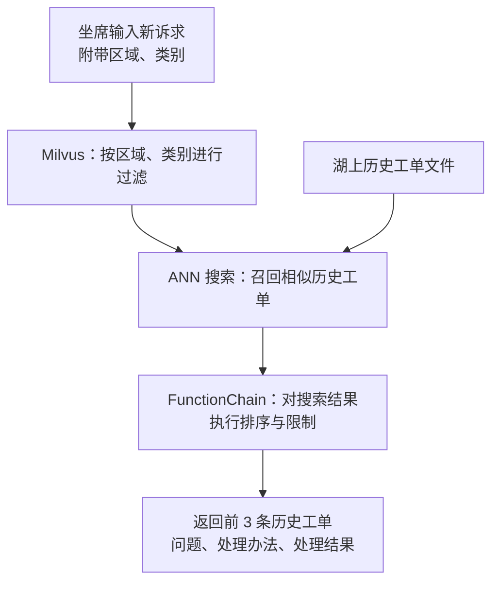
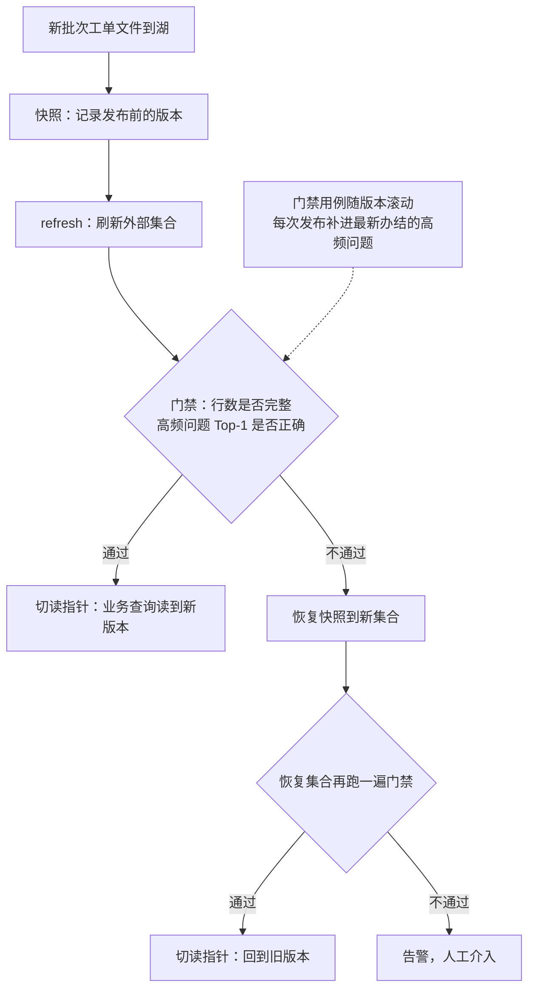
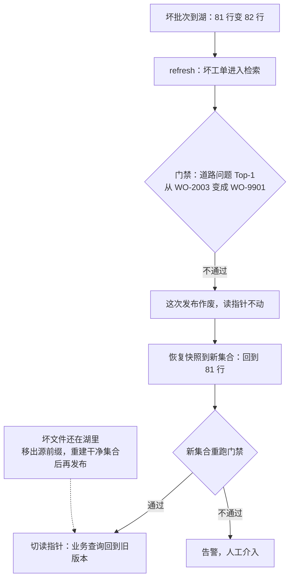
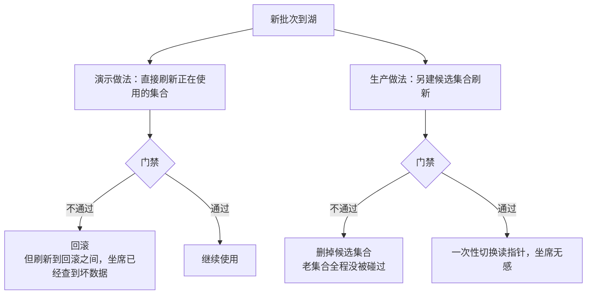

# Chapter 7.5B 端到端实战：12345历史工单智能检索与知识发布系统

> 7.2 把外部集合与快照逐个跑通；7.5B 把它们组装成一个完整的业务系统——12345 历史工单的智能检索与知识发布。

## 7.5B.0 历史工单智能检索

先看一个问题。12345 热线转来一件市民诉求：

```text
朝晖小区北门路面破损严重，雨天积水，居民多次反映至今未解决。
```

关键词搜索可能命中「道路维修」，却找不到半年前真正有用的《朝晖小区北门路面修复与排水改造》。你可能会想：按小区名搜索不就行了吗？不行——同名小区的历史记录一多，返回一大堆结果，坐席仍要逐条核对；何况很多业务人员手里用的甚至不是系统，而是一份份 Excel。真正缺的是「语义检索 + 按区域、类别筛选」，直接把最相似、处置有效的历史工单放到坐席面前。

**历史工单智能检索系统**解决的就是这件事

整体数据流：12345 办结工单 → 湖上 Parquet 批次 → 外部 Collection → advise 供坐席参考——常规方案里搭 ETL 链路定时同步进 Milvus 的环节整个省掉；发布流程 = 快照 → 高频问题搜索门禁 → 失败回滚、切读指针。


## 7.5B.1 数据准备

不需要手工准备数据：配套 notebook 造 80 条历史工单，调用 embedding 模型向量化后写成湖上 Parquet 批次。

进 notebook 前先看一眼路线：造数据 → 建视图（外部 Collection）→ 查询 → 发布（快照/门禁/切读）→ 一次好增量、一次坏增量与回滚。

---

## 7.5B.2 查询

查询只做一件事：坐席给一件新诉求，系统返回最值得参考的历史工单。




---

## 7.5B.3 发布：把“刷新”升级成可回退的发布

发布只做一件事：新批次先过门禁再切读，不通过就退回旧版本。



发布成功 = 门禁通过、指针已切、业务查询真的读它，三条同时成立。

---

## 7.5B.4 一次正常增量

一个月后同一小区又来一单：夜间燃气施工后回填不实，路面反复沉降（`WO-2101`）。发布要同时验证两件事：新诉求召回 `WO-2101`，原来的道路破损仍召回 `WO-2003`——新记录不能把旧经验挤掉。

发布后：知识库从 80 行变成 81 行，`WO-2101` 可查，旧召回不变。新知识进得来、旧经验没被挤掉，这才是一次有业务意义的增量。

---

## 7.5B.5 一次坏增量：门禁失败与切换式回滚

> 这个非常重要，实际业务场景中会经常出现此问题！

坏增量不是文件损坏，而是混进了一条内容错误的工单：诉求和正常工单一字不差，处置却是空的。

| 工单 | 诉求 | 处置 | 检索时 |
|---|---|---|---|
| WO-2003（正确） | 朝晖小区北门路面破损，坑洼积水 | 围挡、回填、排水改造 | 应该排第一 |
| WO-9901（坏） | 和上面完全相同 | 只写“已办结归档” | 实际压过了 2003 |

坐席照着 9901 答复，等于告诉市民“问题已解决”。而行数只是从 81 变成 82，查行数根本发现不了——只有拿高频问题真的去搜，才暴露得出来。



快照恢复的用途就在这里：新批次先考试，考不过就不上线。恢复的只是检索视图，湖里的坏文件要靠移出源前缀来隔离。

---

## 7.5B.6 生产化：先解决发布的那几秒

这套系统适合低频追加、读多写少、结果只做建议的知识库，不当高并发业务主库。

上生产前最要紧的是**发布窗口**：原地刷新时，新批次已经能查到、门禁却还没判完，中间这几秒坐席可能拿到坏工单。12345 服务全市居民，瞬时并发高，几秒的坏参考会被放大成成片错误答复，**直接影响考核指标**。解决办法是换个地方刷新——不在正在使用的集合上动，另建候选集合，门禁过了才切换：



- **切指针要一次完成** 。
- **候选集合存在期间两套索引并存，资源多占一份** 。

---

## 7.5B.7 小结

只记住一句话：**端到端不是把 `refresh`、`snapshot`、`restore` 依次调用一遍，而是让一条业务链路在正常、增量和失败三种状态下都有人负责。**

在这个系统里：

- 外部 Collection 解决“历史知识如何不搬迁地被检索”；
- 刷新解决“新批次如何进入视图”；
- 快照和恢复解决“坏批次如何退回上一个可信版本”；
- `active_collection` 指针解决“业务到底在读哪个版本”；
- 质量门禁解决“什么时候可以宣告发布成功”。

**参考文档**：[创建外部 Collection](https://milvus.io/docs/zh/create-an-external-collection.md) · [管理快照](https://milvus.io/docs/zh/manage-snapshots.md) · [快照用例](https://milvus.io/docs/zh/snapshot-use-cases.md) · [存储 V3](https://milvus.io/docs/zh/storage-v3.md)

> **上一节**：[7.5A 官方实战项目精讲](./7.5A-Milvus3.0官方实战项目精讲)　·　**深入阅读**：[7.6 深入与进阶](./7.6-深入与进阶)　·　**基础回顾**：[7.2 外部集合与快照](./7.2-Milvus3.0外部集合与快照)
